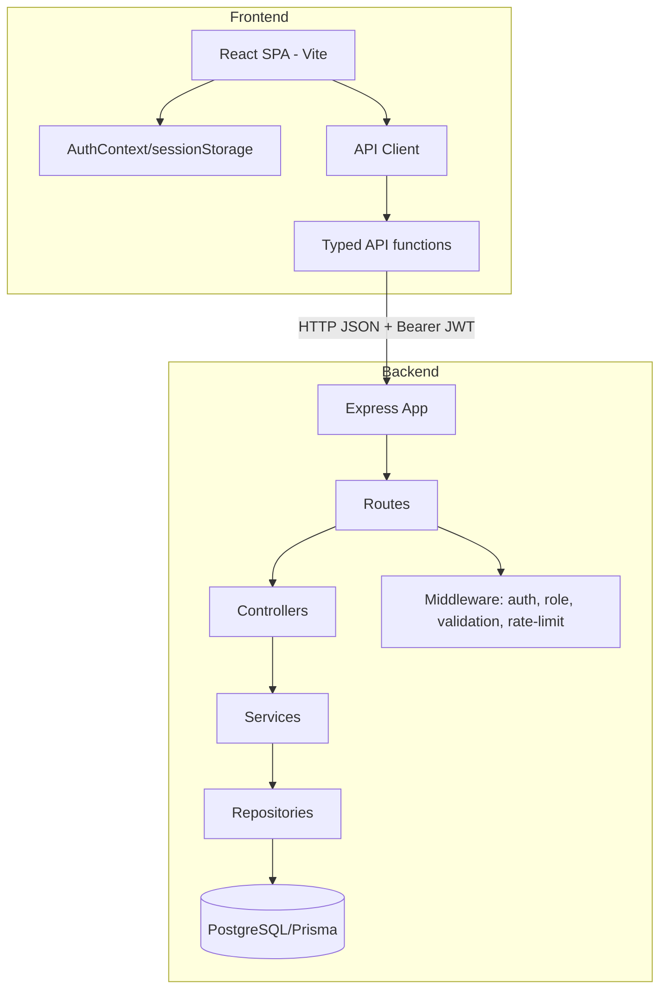

# Car Dealership Inventory

A full-stack vehicle inventory system with a role-based API and a React frontend. The backend enforces admin-only writes, atomic one-unit purchases, strict validation, and secure auth flows. The frontend provides a responsive dashboard with debounced search, purchase flows, and admin management tools.

## Tech stack

### Backend
- **Runtime:** Node.js 20+, TypeScript 7
- **Framework:** Express 5.3.0
- **Database:** PostgreSQL with Prisma 5.22.0
- **Auth:** bcrypt 6.0.0, jsonwebtoken 9.0.3 (HS256)
- **Validation:** Zod 4.6.7
- **Security:** helmet 8.1.0, cors 2.8.5, express-rate-limit 8.7.1
- **Testing:** Vitest 5.0.5, Supertest 7.3.1

### Frontend
- **Build:** Vite 8.3.5
- **Framework:** React 19.3.1, TypeScript 7.0.2
- **Routing:** React Router 7.18.4
- **Styling:** Tailwind CSS 3.4.19
- **Testing:** Vitest 5.0.5, React Testing Library 16.3.3, @testing-library/user-event 14.6.8, jsdom 29.1.1
- **State:** React Context + hooks only (no UI/state libraries)

## Architecture



**Key points:**
- **Backend layering:** `routes → controllers → services → repositories`. Prisma client is only used inside repositories via `src/lib/prisma.ts`. Business logic lives in services.
- **Frontend architecture:** `src/api` (fetch client + typed functions), `src/auth` (AuthContext + session handling), `src/components` (guards, UI), `src/pages` (views). The API client parses the backend `{ error: {...} }` envelope into a typed `ApiError`, attaches Bearer tokens, and on 401 clears the session and redirects to `/login`.
- **Security boundary:** The server is always the authority. The frontend decodes JWT claims only for UI display; admin checks are enforced server-side.

## Local setup

### Prerequisites
- Node.js 20+
- PostgreSQL 15+ on `localhost:5432` (Windows service `postgresql-x64-*` or Docker)

**Ports:** backend **3000** (`PORT` in `backend/.env`); frontend **5173** with `/api` proxied to `http://localhost:3000` (`frontend/vite.config.ts`).

### First-time setup (PowerShell)

1. **Postgres:** confirm `Test-NetConnection localhost -Port 5432` succeeds. Start the PostgreSQL Windows service if needed (may require admin).
2. **Databases:** create `dealership_dev` and `dealership_test` (name must end with `_test` for Vitest). Use `psql` or pgAdmin if installed; Prisma `migrate deploy` also expects `dealership_dev` to exist.
3. **Backend env (never committed):**
   ```powershell
   cd backend
   npm install
   npm run setup:env
   ```
   Creates `backend/.env` from `.env.example` only when missing; generates `JWT_SECRET` (48 random bytes, base64) and `ADMIN_PASSWORD` without printing them. Open `backend/.env` locally for `ADMIN_EMAIL` (`admin@autoyard.local`) and `ADMIN_PASSWORD`.
4. **Schema & seed:**
   ```powershell
   npx prisma migrate deploy
   npx prisma generate
   npx prisma db seed
   npm run seed:demo
   ```
5. **Run servers (two terminals):**
   ```powershell
   cd backend; npm run dev
   cd frontend; npm install; npm run dev
   ```
6. **Smoke check:** `curl.exe http://localhost:3000/health` → 200; `curl.exe http://localhost:5173/api/vehicles` → 401 (proxy to backend).

### Troubleshooting

| Symptom | Likely cause | Fix |
| --- | --- | --- |
| `JWT_SECRET: expected string, received undefined` | No `backend/.env` | `npm run setup:env` in `backend/` |
| `ECONNREFUSED` / Prisma can't reach DB | Postgres stopped or wrong `DATABASE_URL` | Start PostgreSQL; match user/password/host in `.env.example` (`postgres`/`postgres`@`localhost:5432`) |
| Missing `imageUrl` column | Migrations not applied on dev DB | `npx prisma migrate deploy` in `backend/` |
| `TRUST_PROXY` validation error | Invalid value in `.env` | Use `false` locally, or a numeric hop count behind a proxy — not `true` |
| Browser `502` on `/api/*` | Backend not listening on port 3000 | Start `npm run dev` in `backend/`; confirm `PORT` matches Vite proxy target |

`.env` files are git-ignored — never commit them. Before commits, run `git check-ignore backend/.env` and ensure `git status` shows no `.env` staged.

### Frontend (daily dev)
1. `cd frontend`
2. `npm install` (first time)
3. `npm run dev` — optional `frontend/.env` with `VITE_API_URL`; dev proxy handles `/api` without it
4. Quality gate: `npm run build && npx tsc --noEmit && npm run lint && npm test`

See [`backend/README.md`](backend/README.md) for trust proxy details.

## API table

All vehicle routes require `Authorization: Bearer <jwt>`. Error responses follow `{ "error": { "code": string, "message": string, "details"?: unknown } }`.

| Method | Path | Auth | Notes |
| --- | --- | --- | --- |
| POST | `/api/auth/register` | Public + rate limited | Registers as `USER`; rejects unknown fields; returns `{ user, token }` (no passwordHash) |
| POST | `/api/auth/login` | Public + rate limited | Identical 401 for unknown/wrong password; dummy hash used for unknown email; returns `{ user, token }` |
| GET | `/api/vehicles` | Authenticated | List all vehicles (includes quantity 0). Each item includes core fields, optional spec fields, `imageUrl`, and ISO `createdAt` / `updatedAt`. |
| GET | `/api/vehicles/search` | Authenticated | Search: make/model case-insensitive contains; category case-insensitive exact; minPrice/maxPrice inclusive; optional `fuelType`, `minYear`, `maxOdometerKm`; `minPrice > maxPrice` → 400. Registered before `/:id`. |
| GET | `/api/vehicles/:id` | Authenticated | Single vehicle by UUID. **200** with full DTO; **400** if `id` is not a UUID; **404** if not found. |
| POST | `/api/vehicles` | Admin | Create vehicle (core + optional specs + optional `imageUrl`). See [Vehicle fields](#vehicle-fields-and-validation). |
| PUT | `/api/vehicles/:id` | Admin | Partial update of core fields, specs, and `imageUrl`. **Quantity cannot be updated via PUT** (send `quantity` → 400). Empty body → 400. |
| DELETE | `/api/vehicles/:id` | Admin | Returns 204 on success |
| POST | `/api/vehicles/:id/purchase` | Authenticated | Exactly 1 unit, atomic conditional decrement; 409 `OUT_OF_STOCK` if unavailable |
| POST | `/api/vehicles/:id/restock` | Admin | Body `{ amount }` integer 1-10000; increments quantity |
| GET | `/health` | Public | `{ "status": "ok" }` |

## Error codes (common)
- `INVALID_CREDENTIALS` (401) - login failures
- `UNAUTHORIZED` (401) - missing/invalid/expired/wrong-alg token
- `FORBIDDEN` (403) - authenticated but insufficient role
- `BAD_REQUEST` / validation codes (400) - Zod failures, invalid ranges
- `NOT_FOUND` (404) - unknown resource/invalid UUID in some cases
- `OUT_OF_STOCK` (409) - purchase when unavailable
- `CONFLICT` (409) - duplicate email on register
- `TOO_MANY_REQUESTS` (429) - auth rate limit exceeded
- `INTERNAL_ERROR` (500) - generic, no stack traces

## Vehicle fields and validation

All create/update bodies use **strict** Zod schemas (unknown keys → 400). Spec fields are optional on create and may be omitted, set, or sent as `null` to clear on update.

| Field | Create | Update | Rules |
| --- | --- | --- | --- |
| `make` | required | optional | string, 1–100 chars |
| `model` | required | optional | string, 1–100 chars |
| `category` | required | optional | string, 1–100 chars |
| `price` | required | optional | number ≥ 0 |
| `quantity` | required | **not allowed** | non-negative integer on create only |
| `imageUrl` | optional | optional | `null`, `https://…`, or site-relative path starting with `/` (max 2048). Rejects `javascript:`, `data:`, `file:`, `http:`, `//`, whitespace/control chars |
| `year` | optional | optional | integer 1980 … current calendar year + 1, or `null` |
| `odometerKm` | optional | optional | integer 0–2,000,000, or `null` |
| `engineCc` | optional | optional | integer 50–10,000, or `null` |
| `powerBhp` | optional | optional | integer 1–2,000, or `null` |
| `torqueNm` | optional | optional | integer 1–3,000, or `null` |
| `fuelType` | optional | optional | `PETROL`, `DIESEL`, `ELECTRIC`, `HYBRID`, `PLUG_IN_HYBRID`, `CNG`, `LPG`, or `null` |
| `transmission` | optional | optional | `MANUAL`, `AUTOMATIC`, `CVT`, `DCT`, or `null` |
| `drivetrain` | optional | optional | `FWD`, `RWD`, `AWD`, `FOUR_WD`, or `null` |
| `fuelEconomyKmpl` | optional | optional | number 0.1–100, or `null` |
| `color` | optional | optional | letters, spaces, hyphens; max 32; or `null` |
| `owners` | optional | optional | integer 1–10, or `null` |
| `vin` | optional | optional | 17 chars (excludes I/O/Q), or `null` |

**Search query (GET `/api/vehicles/search`):** optional `make`, `model`, `category`, `minPrice`, `maxPrice`, `fuelType`, `minYear`, `maxOdometerKm` (same enums/ranges as above where applicable).

### Sample / demo data disclaimer

`npm run seed:demo` fills inventory with **illustrative** make/model/spec values for UI and API demos. They are **not** verified against real manufacturer data, VIN registries, or emissions tests. Do not treat seeded specs as factual listings.

## Assumptions and design decisions

- **Admin-only writes:** `POST/PUT/DELETE /api/vehicles` and `POST /:id/restock` require `ADMIN`. This prevents unauthorized inventory changes while allowing customers to purchase. The frontend hides admin controls for `USER`, but never relies on it for security.
- **One-unit purchase:** `POST /:id/purchase` takes no body and decrements exactly 1 unit atomically with `quantity > 0` guard (409 `OUT_OF_STOCK` on failure). This prevents oversells without complex cart logic.
- **Search semantics:** `/search` is registered before `/:id` to avoid route shadowing. make/model use case-insensitive contains implemented with PostgreSQL `ILIKE ... ESCAPE '\'` so `%`, `_`, and `\` in user input match literally; category uses case-insensitive exact match; price filters are inclusive; invalid ranges return 400.
- **Auth behavior:** Bcrypt cost 12, password 8-72 chars and <=72 UTF-8 bytes. On login, unknown emails still run bcrypt compare against a dummy hash to mitigate user enumeration/timing leaks; error messages are identical. JWT HS256 pinned on sign and verify, 15m expiry. Tokens stored in **sessionStorage** (cleared on tab close) as a tradeoff: reduces persistent XSS exposure vs localStorage, but is still vulnerable to XSS - treat it as non-httpOnly client storage and rely on CSP/sanitization.
- **Trust proxy/rate limiting:** Auth endpoints are rate-limited per client IP. Behind reverse proxies, set `TRUST_PROXY` to the exact hop count (e.g., `1`); **never use `true`** (only `false`/unset, positive integer, or IP/subnet string). The limiter keys on `req.ip` and returns the standard error envelope on 429 (single-instance in-memory store; see below).
- **Validation & safety:** Zod validates every endpoint with strict schemas (reject unknown fields). No stack traces in 500 responses. `passwordHash` never returned. PUT disallows quantity changes. CORS limited to `CORS_ORIGIN`.
- **Error envelope:** All API errors follow the standardized envelope for consistent frontend parsing.
- **Rate limiting & scaling:** Auth routes are rate-limited only (`/api/auth`). The limiter uses `express-rate-limit`'s in-memory store and is a **single-instance assumption** (no shared store like Redis) - in multi-replica deployments, limits will be per instance; swap to a shared store (e.g., `rate-limit-redis`) if scaling horizontally.
- **Prisma placement:** `prisma` is listed as a dependency (not only devDependency) because `prisma migrate deploy` is used at build/deploy time and the Prisma CLI/schema may be required in production containers/images without dev dependencies installed.
- **Frontend UX:** Debounced search (300ms), min<=max validation before sending, out-of-stock buttons disabled with label, purchase shows loading and on success updates stock in place with a success toast; on 409 patches that card to quantity 0 (no full-page reload) with a "Just sold out" toast, admin quantity field omitted on edit, delete requires confirmation, restock integer 1-10000. **Vehicle details** at `/vehicles/:id` shows a large image panel, sticky purchase panel (desktop), optional overview text and feature chips, and a spec grid (rows with no value hidden; EV/hybrid range and battery rules).
- **Optional specs (API + admin):** `seats`, `rangeKm`, `batteryKwh`, `description` (plain text, max 600), `features` (max 12 strings). All optional on create/update; `features` defaults to `[]`.
- **Featured carousel:** In-stock vehicles only, sorted by `createdAt` descending, maximum six slides (documented on the dashboard).
- **Visual design:** Dark premium showroom UI; implementation, branding, and imagery are original. **Typography:** Sora (display — titles, prices) and Inter (body, forms, tabular spec values), self-hosted via Fontsource (`@fontsource-variable/sora` / `inter` @ 5.3.0, latin subset in `src/fonts/latin-fonts.css`). **Tokens:** near-black surfaces, electric-blue accent, 20px card radius, glass top bar, `max-w-shell` (1280px). Customize in `tailwind.config.js`, `src/index.css` (`:root` CSS variables), and `src/utils/designTokens.ts` (WCAG contrast pairs).

## Vehicle images

- **Optional URL:** `imageUrl` is nullable. Leave the admin **Image URL (optional)** field empty and the storefront shows a **category illustration** (one of the original SVGs in `frontend/public/cars/`, matched by category name). You can still set an explicit URL when you have one.
- **Formats:** `https://` URLs or site-relative paths such as `/cars/sedan-01.svg` (max 2048 characters). Dangerous schemes (`http:`, `javascript:`, `data:`, `file:`, protocol-relative `//`) are rejected server-side and in admin forms.
- **No upload:** File upload is not implemented so the API stays stateless and we avoid storage, virus scanning, and size-limit concerns. Images are referenced by URL only; host files under `frontend/public/cars/` or on an HTTPS CDN.
- **Local assets:** Add files under `frontend/public/cars/` and reference `/cars/<filename>` in admin, or rely on category illustrations with an empty URL. Demo inventory: `cd backend && npm run seed:demo` (refuses `NODE_ENV=production` and databases whose name ends with `_test`).
- **Demo photographs:** Wikimedia Commons JPEGs (when fetched) with credits in [`CREDITS.md`](CREDITS.md) and `/credits`. Human review: `cd backend && npm run generate:photo-review` (writes git-ignored `docs/design/photo-review.html`; populate `.cache/car-photo-candidates.json` via `fetch:car-photos` when wired).
- **Illustrative sample data:** Demo vehicles use approximate figures for a typical trim, not an official specification sheet; photos show real models but may differ by model year or trim.
- **Credits:** See [`CREDITS.md`](CREDITS.md) for the bundled SVG illustrations.

## Performance

Measure before optimizing; keep before/after tables in `docs/ai-reports/P1-REPORT.md`, `P2-REPORT.md`, and `P3-REPORT.md`.

| Budget | Limit | Check |
| --- | ---: | --- |
| Total JS (gzip, `dist/assets/*.js`) | 110 kB | `cd frontend && npm run build && npm run check:bundle-size` |
| CSS (gzip) | 10 kB | same script |

**Lighthouse (public pages):** build + `npx vite preview --port 4173`, then `npx lighthouse http://127.0.0.1:4173/login --chrome-flags="--headless=new" --only-categories=performance` (and `/credits`). Authenticated dashboard/details need a logged-in session and are not headless-audited the same way.

**API latency:** `cd backend && npm run build && npm start`, then `npx tsx scripts/measure-api-latency.ts` (200 sequential requests per endpoint).

**Deployment caching:** Vite emits hashed filenames under `dist/assets/` — configure the static host with long `Cache-Control` for `/assets/*`. Files in `frontend/public/cars/` are **not** content-hashed; set a sensible TTL (or versioned paths) on the host. API responses use `Cache-Control: private, no-cache` with ETags for conditional GETs. Enable **gzip/brotli** at the reverse proxy (not in Express).

**Prisma:** one `PrismaClient` in `src/lib/prisma.ts`; the server calls `$connect()` before listening and `$disconnect()` on shutdown. Tune pool size via `DATABASE_URL` / provider docs.

## Test report

### Database hygiene for tests and smoke checks
- **Automated tests** always use the Postgres database whose name ends with `_test` (see `backend/tests/setup.ts`). Never point Vitest at `dealership_dev`.
- **Verification or smoke scripts** that insert rows must either run against `_test` or **delete every row they create** when finished. Do not leave `RUN*`, `E2E*`, `Test*`, or `demo-seed` inventory in `dealership_dev`. To clean dev: `cd backend && npx tsx scripts/cleanup-dev-verification-rows.ts` (lists matching rows, then deletes them; refuses `_test` and production).

### Backend
**Command:** `npm test` (from `backend/`, requires Postgres DB whose name ends with `_test`; migrations run automatically)  
**Output (actual, RUN3):**
```
 Test Files  25 passed (25)
      Tests  114 passed (114)
```

**Coverage (actual, RUN3):** `npm run test:coverage`
```
=============================== Coverage summary ===============================
Statements   : 94.41% ( 338/358 )
Branches     : 87.31% ( 179/205 )
Functions    : 100% ( 86/86 )
Lines        : 94.39% ( 337/357 )
================================================================================
```

### Frontend
**Command:** `npm test` (from `frontend/`)  
**Output (actual, RUN3):**
```
 Test Files  36 passed (36)
      Tests  122 passed (122)
```

**Coverage (actual, RUN3):** `npm run test:coverage`
```
=============================== Coverage summary ===============================
Statements   : 78.14% ( 783/1002 )
Branches     : 73.34% ( 553/754 )
Functions    : 74.42% ( 195/262 )
Lines        : 80.06% ( 731/913 )
================================================================================
```

Coverage is measured from files loaded by the test suite (V8); admin pages and dialogs with lighter test coverage are included in the summary above.

### Audits
- Backend `npm audit --omit=dev`: **found 0 vulnerabilities**
- Frontend `npm audit --omit=dev`: **found 0 vulnerabilities**
- Backend production deps had 2 high advisories resolved (express-rate-limit 8.7.1, ip-address 10.7.4)

## Screens and routes

### Frontend routes
| Path | Component | Access | Description |
| --- | --- | --- | --- |
| `/login` | LoginPage | Public | Email/password login with validation and server error display |
| `/register` | RegisterPage | Public | Registration (USER only) with validation mirroring server rules |
| `/` | DashboardPage | Protected | Vehicle grid, debounced search/filters, purchase flow, admin shortcuts |
| `/vehicles/:id` | VehicleDetailsPage | Protected | Large image, sticky purchase panel (desktop), full spec grid |
| `/admin/vehicles/new` | AddVehiclePage | Admin only | Create vehicle (core fields, optional specs, optional image URL) |
| `/admin/vehicles/:id/edit` | EditVehiclePage | Admin only | Edit core fields and specs, restock (1-10000), delete with confirmation |
| `*` | NotFoundPage | Public | 404 page |

### Screens (placeholders)
Screenshots are expected at `docs/screenshots/*.png`. Placeholders are tracked in `docs/screenshots/.gitkeep`. Suggested captures: login, register, dashboard (with filters), out-of-stock card, admin create, admin edit/restock/delete.

## Security notes
- No `dangerouslySetInnerHTML`, `eval`, or `new Function` used.
- No secrets committed; only `.env.example` files present.
- Frontend only uses `VITE_API_URL` (no secrets in bundle).
- Auth token stored in `sessionStorage` (documented tradeoff above). Decoded only for UI display.
- Admin UI hidden for non-admins but all writes validated/authorized server-side.
- CORS must match backend `CORS_ORIGIN`.

## Development commands

### Run both apps
No root package manager is used. Open two terminals:

```bash
# Terminal 1 - API on http://localhost:3000
cd backend && npm run dev

# Terminal 2 - web app on http://localhost:5173
cd frontend && npm run dev
```

Set `VITE_API_URL=http://localhost:3000` in `frontend/.env` and keep backend `CORS_ORIGIN=http://localhost:5173` (the defaults).

### Run full verification
```bash
# Backend
cd backend
npm test && npx tsc --noEmit && npm run build && npm run test:coverage && npm audit --omit=dev

# Frontend
cd frontend
npm test && npm run test:coverage && npx tsc --noEmit && npm run lint && npm run build && npm audit --omit=dev
```

## Known limitations and provenance

- **Commit hygiene:** Some early backend commits and several frontend commits combine test and source changes in a single commit, which diverges from the strict RED/GREEN commit plan used later in the project.
- **Co-author trailers:** Commits from `bae3c8c` through `25d61ad` were produced in an Antigravity session but carry an OpenCode `Co-authored-by` trailer; earlier commits were made with Cursor. History was intentionally not rewritten.
- **Duplicate commits:** `d453d21` and `a136e0d` are duplicate authorization-matrix lock-in commits.
- **Rate limiting:** Auth rate limits use an in-memory store (single-instance assumption); horizontal scaling would need a shared store.

## Additional references
- Prompt history (raw): [`PROMPTS.md`](PROMPTS.md)
- Auditor prompts (raw): [`TESTPROMPTS.md`](TESTPROMPTS.md)
- Backend details: [`backend/README.md`](backend/README.md)
- Cursor agent session reports (build/fix/UI passes): [`docs/ai-reports/`](docs/ai-reports/)

## My AI Usage

[TODO: my own words]

**Tools used:** Cursor, OpenCode, Antigravity  
**How each was used (draft):**
- **Cursor:** [TODO: describe session(s), what was reviewed/rejected/changed]  
- **OpenCode:** [TODO: describe TDD phases, scaffolding, commits, verification runs, what was rejected/changed]  
- **Antigravity:** [TODO: describe usage, insights applied or discarded]  

**Reflection (honest):** [TODO: my own words - what I learned, where I disagreed with AI suggestions, verification steps I took, and lessons for future work]
