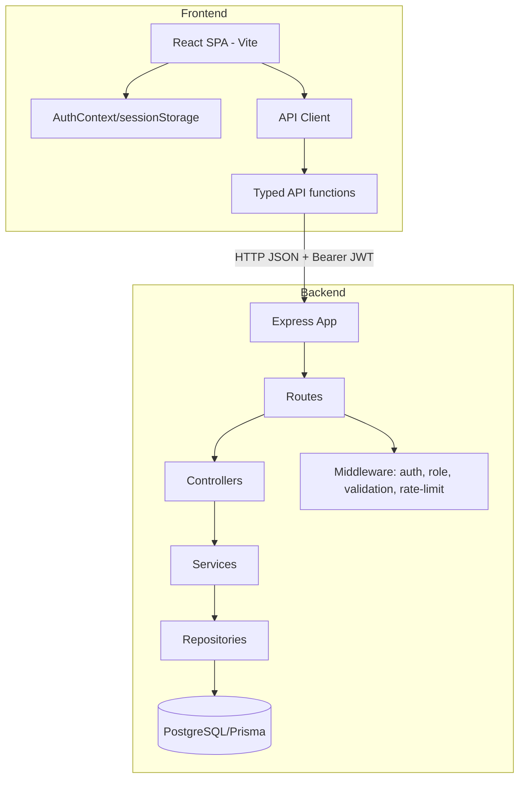

# Car Dealership Inventory

A full-stack vehicle inventory system with a role-based API and a React frontend. The backend enforces admin-only writes, atomic one-unit purchases, strict validation, and secure auth flows. The frontend provides a responsive dashboard with debounced search, purchase flows, and admin management tools.

## Tech stack

### Backend
- **Runtime:** Node.js 20+, TypeScript 7
- **Framework:** Express 5.3.0
- **Database:** PostgreSQL with Prisma 5.22.0
- **Auth:** bcrypt 6.0.0, jsonwebtoken 9.0.3 (HS256)
- **Validation:** Zod 4.6.7
- **Security:** helmet 8.1.0, cors 2.8.5, express-rate-limit 8.7.1
- **Testing:** Vitest 5.0.5, Supertest 7.3.1

### Frontend
- **Build:** Vite 8.3.5
- **Framework:** React 19.3.1, TypeScript 7.0.2
- **Routing:** React Router 7.18.4
- **Styling:** Tailwind CSS 3.4.19
- **Testing:** Vitest 5.0.5, React Testing Library 16.3.3, @testing-library/user-event 14.6.8, jsdom 29.1.1
- **State:** React Context + hooks only (no UI/state libraries)

## Architecture



**Key points:**
- **Backend layering:** `routes → controllers → services → repositories`. Prisma client is only used inside repositories via `src/lib/prisma.ts`. Business logic lives in services.
- **Frontend architecture:** `src/api` (fetch client + typed functions), `src/auth` (AuthContext + session handling), `src/components` (guards, UI), `src/pages` (views). The API client parses the backend `{ error: {...} }` envelope into a typed `ApiError`, attaches Bearer tokens, and on 401 clears the session and redirects to `/login`.
- **Security boundary:** The server is always the authority. The frontend decodes JWT claims only for UI display; admin checks are enforced server-side.

## Local setup

### Prerequisites
- Node.js 20+
- PostgreSQL 15+ running locally (or via Docker)

### Backend
1. `cd backend`
2. `cp .env.example .env` - set `JWT_SECRET` (>=32 chars), DB URLs, admin creds
3. Create databases: `dealership_dev` and `dealership_test` (test DB name must end with `_test`)
4. `npm install`
5. `npx prisma migrate deploy` (dev: `npx prisma migrate dev --name <change>`)
6. `npx prisma db seed` (requires `ADMIN_EMAIL` and `ADMIN_PASSWORD`)
7. `npm run dev` (defaults to port 3000)

See [`backend/README.md`](backend/README.md) for details including trust proxy configuration.

### Frontend
1. `cd frontend`
2. `cp .env.example .env` - set `VITE_API_URL` (must match backend origin, e.g. `http://localhost:3000`)
3. `npm install`
4. `npm run dev` (Vite dev server)
5. `npm run build && npx tsc --noEmit && npm run lint && npm test`

## API table

All vehicle routes require `Authorization: Bearer <jwt>`. Error responses follow `{ "error": { "code": string, "message": string, "details"?: unknown } }`.

| Method | Path | Auth | Notes |
| --- | --- | --- | --- |
| POST | `/api/auth/register` | Public + rate limited | Registers as `USER`; rejects unknown fields; returns `{ user, token }` (no passwordHash) |
| POST | `/api/auth/login` | Public + rate limited | Identical 401 for unknown/wrong password; dummy hash used for unknown email; returns `{ user, token }` |
| GET | `/api/vehicles` | Authenticated | List all vehicles (includes quantity 0) |
| GET | `/api/vehicles/search` | Authenticated | Search: make/model case-insensitive contains; category case-insensitive exact; minPrice/maxPrice inclusive; `minPrice > maxPrice` → 400. Route registered before `/:id`. |
| POST | `/api/vehicles` | Admin | Create vehicle. Max 100 chars for make/model/category; price non-negative; quantity non-negative integer |
| PUT | `/api/vehicles/:id` | Admin | Partial update of make/model/category/price only. **Quantity cannot be updated via PUT** (400). Empty body → 400 |
| DELETE | `/api/vehicles/:id` | Admin | Returns 204 on success |
| POST | `/api/vehicles/:id/purchase` | Authenticated | Exactly 1 unit, atomic conditional decrement; 409 `OUT_OF_STOCK` if unavailable |
| POST | `/api/vehicles/:id/restock` | Admin | Body `{ amount }` integer 1-10000; increments quantity |
| GET | `/health` | Public | `{ "status": "ok" }` |

## Error codes (common)
- `INVALID_CREDENTIALS` (401) - login failures
- `UNAUTHORIZED` (401) - missing/invalid/expired/wrong-alg token
- `FORBIDDEN` (403) - authenticated but insufficient role
- `BAD_REQUEST` / validation codes (400) - Zod failures, invalid ranges
- `NOT_FOUND` (404) - unknown resource/invalid UUID in some cases
- `OUT_OF_STOCK` (409) - purchase when unavailable
- `CONFLICT` (409) - duplicate email on register
- `TOO_MANY_REQUESTS` (429) - auth rate limit exceeded
- `INTERNAL_ERROR` (500) - generic, no stack traces

## Assumptions and design decisions

- **Admin-only writes:** `POST/PUT/DELETE /api/vehicles` and `POST /:id/restock` require `ADMIN`. This prevents unauthorized inventory changes while allowing customers to purchase. The frontend hides admin controls for `USER`, but never relies on it for security.
- **One-unit purchase:** `POST /:id/purchase` takes no body and decrements exactly 1 unit atomically with `quantity > 0` guard (409 `OUT_OF_STOCK` on failure). This prevents oversells without complex cart logic.
- **Search semantics:** `/search` is registered before `/:id` to avoid route shadowing. make/model use case-insensitive contains; category uses case-insensitive exact match; price filters are inclusive; invalid ranges return 400. `%` and `_` are treated as literal characters (not wildcards) per Prisma parameterization.
- **Auth behavior:** Bcrypt cost 12, password 8-72 chars and <=72 UTF-8 bytes. On login, unknown emails still run bcrypt compare against a dummy hash to mitigate user enumeration/timing leaks; error messages are identical. JWT HS256 pinned on sign and verify, 15m expiry. Tokens stored in **sessionStorage** (cleared on tab close) as a tradeoff: reduces persistent XSS exposure vs localStorage, but is still vulnerable to XSS - treat it as non-httpOnly client storage and rely on CSP/sanitization.
- **Trust proxy/rate limiting:** Auth endpoints are rate-limited per client IP. Behind Render/Vercel (single proxy), set `TRUST_PROXY=1`; never use `TRUST_PROXY=true` as it trusts client headers. The limiter keys on `req.ip` and returns the standard error envelope on 429.
- **Validation & safety:** Zod validates every endpoint with strict schemas (reject unknown fields). No stack traces in 500 responses. `passwordHash` never returned. PUT disallows quantity changes. CORS limited to `CORS_ORIGIN`.
- **Error envelope:** All API errors follow the standardized envelope for consistent frontend parsing.
- **Frontend UX:** Debounced search (300ms), min<=max validation before sending, out-of-stock buttons disabled with label, purchase shows loading and on 409 refreshes that card without full reload with "just sold out" toast, admin quantity field omitted on edit, delete requires confirmation, restock integer 1-10000.

## Test report

### Backend
**Command:** `npm test` (from `backend/`)  
**Output (actual):**
```
 Test Files  9 passed (9)
      Tests  52 passed (52)
   Start at  00:02:03
   Duration  30.72s (tests 87%, import 11%, worker 1%, transform 1%, setup 1%)
```

**Coverage (actual):** `npm run test:coverage`
```
-------------------|---------|----------|---------|---------|-------------------
File               | % Stmts | % Branch | % Funcs | % Lines | Uncovered Line #s 
-------------------|---------|----------|---------|---------|-------------------
All files          |   93.91 |    83.14 |     100 |   93.91 |                   
 src               |     100 |      100 |     100 |     100 |                   
  app.ts           |     100 |      100 |     100 |     100 |                   
 src/config        |   70.58 |    57.14 |     100 |   70.58 |                   
  env.ts           |   66.66 |    57.14 |     100 |   66.66 | 33-39              
  jwt.ts           |     100 |      100 |     100 |     100 |                   
 src/controllers   |    92.3 |      100 |     100 |    92.3 |                   
  ...controller.ts |     100 |      100 |     100 |     100 |                   
  ...controller.ts |      90 |      100 |     100 |      90 | 18,31,45          
 src/errors        |     100 |      100 |     100 |     100 |                   
  ApiError.ts      |     100 |      100 |     100 |     100 |                   
 src/lib           |     100 |      100 |     100 |     100 |                   
  prisma.ts        |     100 |      100 |     100 |     100 |                   
 src/middleware    |   95.34 |       85 |     100 |   95.34 |                   
  errorHandler.ts  |      80 |       50 |     100 |      80 | 16                
  requireAuth.ts   |   91.66 |     87.5 |     100 |   91.66 | 30                
  requireRole.ts   |     100 |      100 |     100 |     100 |                   
  validateBody.ts  |     100 |      100 |     100 |     100 |                   
  ...dateParams.ts |     100 |      100 |     100 |     100 |                   
  validateQuery.ts |     100 |      100 |     100 |     100 |                   
 src/repositories  |   96.42 |    83.33 |     100 |   96.42 |                   
  ...repository.ts |   83.33 |       75 |     100 |   83.33 | 27                
  ...repository.ts |     100 |    85.71 |     100 |     100 | 85-88              
 src/routes        |     100 |      100 |     100 |     100 |                   
  auth.routes.ts   |     100 |      100 |     100 |     100 |                   
  ...les.routes.ts |     100 |      100 |     100 |     100 |                   
 src/services      |   95.74 |     90.9 |     100 |   95.74 |                   
  auth.service.ts  |     100 |      100 |     100 |     100 |                   
  ...le.service.ts |   94.11 |    86.66 |     100 |   94.11 | 81,86              
 src/validators    |     100 |      100 |     100 |     100 |                   
  ...gin.schema.ts |     100 |      100 |     100 |     100 |                   
  ...ter.schema.ts |     100 |      100 |     100 |     100 |                   
  ...ate.schema.ts |     100 |      100 |     100 |     100 |                   
  ...ams.schema.ts |     100 |      100 |     100 |     100 |                   
  ...ock.schema.ts |     100 |      100 |     100 |     100 |                   
  ...rch.schema.ts |     100 |      100 |     100 |     100 |                   
  ...ate.schema.ts |     100 |      100 |     100 |     100 |                   
 tests/helpers     |      90 |       75 |     100 |      90 |                   
  auth.ts          |     100 |      100 |     100 |     100 |                   
  db.ts            |   83.33 |       50 |     100 |   83.33 | 11                
-------------------|---------|----------|---------|---------|-------------------
```

### Frontend
**Command:** `npm test` (from `frontend/`)  
**Output (actual):**
```
 Test Files  5 passed (5)
      Tests  22 passed (22)
   Start at  00:03:00
   Duration  4.54s (environment 66%, tests 18%, setup 11%, import 4%, transform 1%)
```

**Notes:** No coverage script configured in frontend package.json; tests cover API client, auth context, route guards, vehicle card states, and search filters validation.

### Audits
- Backend `npm audit --omit=dev`: **found 0 vulnerabilities**
- Frontend `npm audit --omit=dev`: **found 0 vulnerabilities**
- Backend production deps had 2 high advisories resolved (express-rate-limit 8.7.1, ip-address 10.7.4)

## Screens and routes

### Frontend routes
| Path | Component | Access | Description |
| --- | --- | --- | --- |
| `/login` | LoginPage | Public | Email/password login with validation and server error display |
| `/register` | RegisterPage | Public | Registration (USER only) with validation mirroring server rules |
| `/` | DashboardPage | Protected | Vehicle grid, debounced search/filters, purchase flow, admin shortcuts |
| `/admin/vehicles/new` | AddVehiclePage | Admin only | Create vehicle (make/model/category/price/quantity) |
| `/admin/vehicles/:id/edit` | EditVehiclePage | Admin only | Edit make/model/category/price, restock (1-10000), delete with confirmation |
| `*` | NotFoundPage | Public | 404 page |

### Screens (placeholders)
Screenshots are expected at `docs/screenshots/*.png`. Placeholders are tracked in `docs/screenshots/.gitkeep`. Suggested captures: login, register, dashboard (with filters), out-of-stock card, admin create, admin edit/restock/delete.

## Security notes
- No `dangerouslySetInnerHTML`, `eval`, or `new Function` used.
- No secrets committed; only `.env.example` files present.
- Frontend only uses `VITE_API_URL` (no secrets in bundle).
- Auth token stored in `sessionStorage` (documented tradeoff above). Decoded only for UI display.
- Admin UI hidden for non-admins but all writes validated/authorized server-side.
- CORS must match backend `CORS_ORIGIN`.

## Development commands
- Root/dev docs: see this README and [`backend/README.md`](backend/README.md)
- Run full verification: backend `npm test && npx tsc --noEmit && npm run build && npm audit --omit=dev`; frontend `npm test && npx tsc --noEmit && npm run lint && npm run build && npm audit --omit=dev`

## Additional references
- Prompt history (raw): [`PROMPTS.md`](PROMPTS.md)
- Auditor prompts (raw): [`TESTPROMPTS.md`](TESTPROMPTS.md)
- Backend details: [`backend/README.md`](backend/README.md)

## My AI Usage

[TODO: my own words]

**Tools used:** Cursor, OpenCode, Antigravity  
**How each was used (draft):**
- **Cursor:** [TODO: describe session(s), what was reviewed/rejected/changed]  
- **OpenCode:** [TODO: describe TDD phases, scaffolding, commits, verification runs, what was rejected/changed]  
- **Antigravity:** [TODO: describe usage, insights applied or discarded]  

**Reflection (honest):** [TODO: my own words - what I learned, where I disagreed with AI suggestions, verification steps I took, and lessons for future work]
