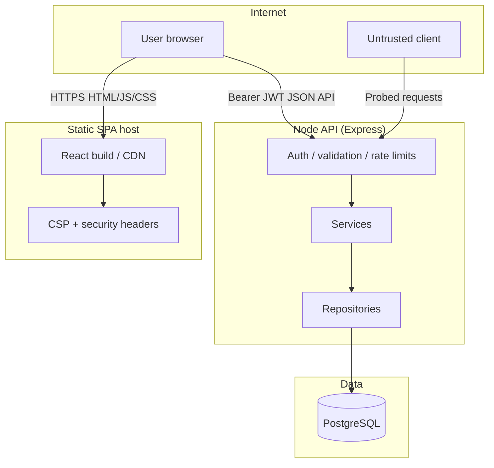

# Security design

This document describes trust boundaries, controls, and deployment expectations for the car-dealership monorepo. Claims are limited to what automated tests and `npm run security:smoke` exercise unless noted as operational (your hosting/DB).

## Assets and trust boundaries

**Trust boundaries**

| Boundary | Trusted side | Untrusted side |
|----------|--------------|----------------|
| Browser ↔ SPA | Same-origin static assets | Any injected script if CSP fails |
| SPA ↔ API | API origin in `VITE_API_URL` / proxy | Other origins (blocked by client + CORS) |
| API ↔ DB | Prisma parameterized queries | Raw SQL from clients |

## STRIDE (selected)

| Threat | Example | Mitigation |
|--------|---------|------------|
| Spoofing | Forged JWT | HS256 only, iss/aud, `tokenVersion`, DB role reload (`requireAuth.ts`) |
| Tampering | Mass assignment / pollution | Zod `.strict()`, `rejectPrototypePollution` |
| Repudiation | Abuse of login | Structured logs + `X-Request-Id` (no passwords/tokens in logs — smoke-tested) |
| Information disclosure | 500 stack / secrets | `errorHandler`, `check:secrets`, log redaction |
| Denial of service | Auth brute force | Login throttle + rate layers |
| Elevation | USER calls admin routes | `requireRole('ADMIN')` + route audit tests |

## OWASP Top 10 (2021) control matrix

| ID | Risk | Control | Code / tests |
|----|------|---------|--------------|
| A01 | Broken access control | JWT + DB `tokenVersion`, role from DB, admin route guards | `requireAuth.ts`, `requireRole.ts`, `authorization.matrix.test.ts`, `security-smoke.ts` |
| A02 | Cryptographic failures | bcrypt, JWT secret entropy, no secrets in frontend bundle | `passwordPolicy.ts`, `env.ts`, `frontend/tests/build-output.security.test.ts` |
| A03 | Injection | Prisma tagged queries, `safeText`, search regression tests | `vehicle.repository.ts`, `sql-injection.search.test.ts` |
| A04 | Insecure design | Rate limits, logout revocation, purchase atomicity | `rateLimits.ts`, `auth.logout.test.ts`, vehicle service tests |
| A05 | Security misconfiguration | Helmet, CORS allow-list, production guards | `helmetOptions.ts`, `production-config.test.ts`, `security-headers.test.ts` |
| A06 | Vulnerable components | `npm audit`, Dependabot, CodeQL workflow | `.github/workflows/ci.yml`, `dependabot.yml` |
| A07 | Auth failures | Login throttle, identical 401 messages, 15m JWT | `loginThrottle.ts`, `auth.login-throttle.test.ts` |
| A08 | Integrity failures | CI, lockfiles, `check:secrets` | `scripts/check-secrets.mjs` |
| A09 | Logging failures | JSON logs, redaction, security events | `logger.test.ts`, `security-smoke.ts` log row |
| A10 | SSRF | No server-side fetch to user URLs for vehicles; image URLs validated | `vehicle.imageUrl.schema.ts`, frontend `isSafeImagePath` |

## Frontend (S3)

| Topic | Implementation | Tests |
|-------|----------------|-------|
| CSP / hosting headers | `frontend/src/security/hostingHeaders.ts` → Vite preview, `public/_headers`, `vercel.json` | `hostingHeaders.test.ts`, `generate-hosting-headers.ts` |
| Session | Token in `sessionStorage` only; user in `dealership_user`; 30m idle logout | `session.security.test.ts`, `AuthContext.test.tsx` |
| API client | `credentials: 'omit'`, `referrerPolicy: 'no-referrer'`, JSON content-type check | `client.test.ts` |
| URL / XSS | `isSafeHttpUrl`, `isSafeImagePath`, `safeHref`, safe login redirects | `safeUrl.test.ts`, `safeRedirect.test.ts`, `lint.mjs` |
| Build | `sourcemap: false`, only `VITE_API_URL` in bundle | `build-output.security.test.ts` |

**CSP notes (documented in code)**

- `style-src 'unsafe-inline'`: Tailwind and inline `style` attributes.
- `img-src https:`: admins may paste arbitrary HTTPS image URLs.
- Dev server does **not** send strict CSP (Vite HMR needs inline scripts).

## Accepted risks

| Risk | Rationale |
|------|-----------|
| `sessionStorage` JWT visible to XSS | Mitigated by strict CSP on static host + no `dangerouslySetInnerHTML`; Bearer header avoids cookie CSRF |
| In-memory rate limit / login lockout | Single-instance deployment; not shared across replicas |
| Register returns **409 `EMAIL_TAKEN`** | Intentional UX; enables email enumeration |
| No MFA, email verification, or password reset | Out of kata scope |
| `img-src https:` on SPA | Required for admin-pasted photo URLs; API still rejects `javascript:` / `data:` |

## Deployment security checklist

| Item | Action |
|------|--------|
| `JWT_SECRET` | ≥48 chars, high entropy; rotate by incrementing all users’ `tokenVersion` or redeploying with new secret (invalidates all sessions) |
| `DATABASE_URL` | Dedicated DB role with least privilege; `sslmode=require` in production (`productionGuards.ts`) |
| `CORS_ORIGIN` | Exact frontend origin(s), comma-separated if multiple |
| `VITE_API_URL` | Production API origin for SPA build and CSP `connect-src` |
| TLS | HTTPS on API and static host |
| Static headers | Run `npm run generate:headers` in `frontend/`; deploy `_headers` (Netlify) or `vercel.json` |
| Backups | `docs/db-roles.sql` + host snapshots; `backups/` gitignored |
| Logs | Forward JSON logs; verify redaction; never log `Authorization` bodies |
| `BCRYPT_COST` | 12+ in production |

### Environment variables (production)

| Variable | Purpose |
|----------|---------|
| `JWT_SECRET`, `JWT_ISSUER`, `JWT_AUDIENCE` | Access tokens |
| `DATABASE_URL` | PostgreSQL |
| `CORS_ORIGIN` | Browser CORS allow-list |
| `PORT`, `TRUST_PROXY` | API listen + reverse proxy |
| `BCRYPT_COST` | Password hashing |
| Rate limit `*_MAX` / `*_WINDOW_MS` | Abuse controls |
| `VITE_API_URL` | Frontend build-time API base |

## What was not done

- WAF / CDN rules
- Professional penetration test
- MFA
- Centralized security monitoring / SIEM
- Shared Redis rate-limit store

## Registration conflicts

`POST /api/auth/register` returns **409** with **`EMAIL_TAKEN`** when the normalized email is already registered (intentional).

`/api/auth/*` uses **express-rate-limit** plus login-failure throttling (**429**, **`Retry-After`**, identical envelopes for known/unknown emails when locked out).

## Rate limiting (single instance)

| Layer | Scope | Default |
|-------|--------|---------|
| Global | Per IP; `/health` skipped | 300 / min |
| Auth | `/api/auth/*` | 100 / 15 min |
| Write | Admin mutations, purchase, restock | 60 / min |

Stores are **in-memory** (one process).
